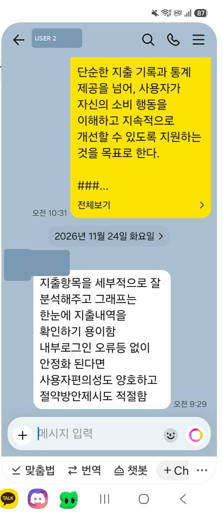

# 사용자 피드백 기록 (USER_FEEDBACK)

[UT_GUIDE.md](UT_GUIDE.md)에 따라 진행한 실사용자 테스트의 참여자, 질문, 응답, 개선 반영 내용을 기록한다(평가 기준 G5·G7).

- 참여 조건: **팀원 제외**, 서비스 타깃(생활비를 관리하는 대학생 / 사회초년생 / 가계부를 쓰다 그만둔 사람)에 해당하는 사람만. 다른 팀 교육생은 타깃에 해당할 때만 인정한다.
- 개인정보: 이름·연락처는 기록하지 않고 T1, T2 …의 가명만 쓴다. 증빙 이미지는 실명·프로필 사진을 가린 파일만 올린다.
- 질문: UT_GUIDE 6장의 설문 Q1~Q10과 진행자 기록표(5장) 항목을 쓴다.

## 1. 집계 현황

| 구분 | 인원 | 비고 |
| --- | --- | --- |
| 피드백 수집 | 5명 | 카카오톡 메시지로 받은 사용 의견 |
| 15분 미션 전체 수행 + 설문 | 5명 | T1·T2는 미션·설문 기록이 없어 보완 필요 |
| **G5 충족 기준** | **5명 이상** | 타깃 근거와 미션 ②~④ 수행 기록이 있는 인원 |

## 2. 테스트 대상

| 가명 | 일자 | 타깃 해당 근거 (Q1) | 방식 | 증빙 |
| --- | --- | --- | --- | --- |
| T1 | 2026-11-24 | 가계부 쓰다 관둠 | 카카오톡 사용 의견 | 익명화 캡처 3장 |
| T2 | 2026-11-24 | 가계부 쓰다 관둠 | 카카오톡 사용 의견 | 익명화 캡처 1장 |
| T3 | 2026-11-24 | 생활비 관리하는 학생 | 15분 미션 + 설문 | 설문지 1장 |
| T4 | 2026-11-24 | 모바일 가계부를 쓰다가 관둠 | 15분 미션 + 설문 | 설문지 1장 |
| T5 | 2026-11-24 | 사회초년생 | 15분 미션 + 설문 | 설문지 1장 |

## 3. 질문과 응답

### T1

| 질문 | 응답 |
| --- | --- |
| ② 이미지 인식 건수 / 고친 칸 수 | 카드명세서 사진을 올렸더니 **지출 내역이 1건만 인식**됐다고 보고. |
| Q2 인식 정확도 | (2점) 명세서에서 1건만 인식돼 불편  |
| Q5 AI 코칭 만족도 | **(4점) 대화 내용이 기록되어 나중에 다시 볼 수 있어 좋다** |
| Q8 불편했던 점 | ① 명세서 다건 인식 ② **글자·화면 크기 때문에 눈이 피로해 오래 대화하기 어려움** ③ **지출 내역이 한 화면에 다 보이지 않아 소비를 분석하기 어려움** |
| Q10 지속 사용 의향 | 눈의 피로가 줄도록 개선되면 계속 써 보고 싶다 (조건부 예) |

### T2

| 질문 | 응답 |
| --- | --- |
| Q5·Q7 분석·코칭 | **지출 항목 세부 분석과 그래프가 한눈에 보기 좋다** |
| Q8 불편했던 점 | **로그인 오류 등이 해결되어 안정화되면** 편의성과 절약 방안 제시가 적절하다 (조건부 평가) |
| Q10 지속 사용 의향 | 있음 |

### T3 

| 질문 | 응답 |
| --- | --- |
| ② 인식 건수 / 고친 칸 수 → 수정 비율 | 14/1 |
| ③ 추천 목표 사용 | O |
| ④ 한 질문 / 근거 열람 / 목표 제안 조치 | 이번달 식비 지출/ |
| Q2~Q7 점수 | 4점 3점-날짜 3점 4점 5점 4점|
| Q8 불편했던 점 | 지출 내역 그래프 화면이 작아서 이용하기 불편하다 |
| Q9 추가 희망 기능 | UI 화면 재구성 |
| Q10 지속 사용 의향 | 있음 |

### T4

| 질문 | 응답 |
| --- | --- |
| ② 인식 건수 / 고친 칸 수 → 수정 비율 | 10/0 |
| ③ 추천 목표 사용 | O |
| ④ 한 질문 / 근거 열람 / 목표 제안 조치 | 지난달보다 뭐가 늘었어? / 카테고리 지출 비교 / 최근 늘어난 카테고리에 대해 한도 설정 |
| Q2~Q7 점수 | 5점 5점 4점 3점 4점 3점 |
| Q8 불편했던 점 | 소비 요약의 분석이 미흡함 |
| Q9 추가 희망 기능 | 소비 요약에서 더 많은 정보를 볼 수 있으면 좋겠음 |
| Q10 지속 사용 의향 | 있음 |

### T5

| 질문 | 응답 |
| --- | --- |
| ② 인식 건수 / 고친 칸 수 → 수정 비율 | 18/3 |
| ③ 추천 목표 사용 | O |
| ④ 한 질문 / 근거 열람 / 목표 제안 조치 | 생활비 줄이는 방법 /  |
| Q2~Q7 점수 | 4점 3점-날짜, 가격 4점 3점 3점 4점 |
| Q8 불편했던 점 | 영수증 인식이 잘 안돼서 직접 하나씩 확인하고 고쳐야하는게 불편했다 |
| Q9 추가 희망 기능 | 영수증 인식 |
| Q10 지속 사용 의향 | 있음 |

## 4. 개선 반영 내용

상위 피드백을 골라 반영하고, 반영 근거(커밋, 전후 화면) 또는 반영하지 않은 이유를 남긴다. 커밋 메시지에는 `UT-T1`처럼 근거가 된 가명을 적는다.

| 피드백 | 출처 | 우선순위 | 결정 | 반영 근거 / 반영하지 않은 이유 |
| --- | --- | --- | --- | --- |
| 카드명세서 사진에서 거래가 1건만 인식됨 | T1 | 중간 | 반영x | 개인정보 없는 다건 명세서 사진으로 재현 → 실제 건수와 인식 건수 비교 → 원인 확인 후 기록 |
| 글자·화면 크기 때문에 눈이 피로함 | T1 | 높음 | 반영o | 사용자 편의성을 위함 |
| 지출 내역 전체를 한눈에 보기 어려움 | T1 | 중간 | 반영o | 사용자 편의성을 위함 |
| 로그인 오류 안정화 필요 | T2 | 높음 | 반영o | 로그인 → 새로고침 → 재로그인 → 세션 유지 시나리오 점검 결과 기록 |
| 지출 내역 화면이 보기 불편함 | T3 | 중간 | 반영o | 사용자 편의성을 위함 |
| 소비 요약 분석-월별 카테고리 지출 비교가 있으면 좋겠음 | T4 | 중간 | 반영o | 소비 분석을 위함 |
| 지출 내역 전체를 한눈에 보기 어려움 | T5 | 중간 | 반영x | 시간부족으로 추후 반영 예정 |
| 분석·그래프가 보기 좋음 (긍정) | T2 | — | 유지 | 장점으로 유지 |
| 대화 기록을 다시 볼 수 있어 좋음 (긍정) | T1 | — | 유지 | 장점으로 유지 |

1. 글자 크기 (T1: "글자가 작아 눈이 피로하다")

- 상단 테마 버튼 옆에 [가] 버튼을 추가. 누를 때마다 기본 → 크게 → 아주 크게로 글자 크기 변경
- 채팅 답변, 입력창, 근거, 소비 알림 카드, 지출 표의 글자가 함께 커짐
- 채팅 답변 줄 간격도 넓혀서 오래 읽기 편하도록 수정
  
2. 지출 내역 탐색 (T1, T5: "내역을 한눈에 보고 분석하기 어렵다")

- 카테고리별 합계 칩: 표 위에 금액이 큰 순으로 "식비 326,800원 · 배달 272,100원…"이 보이고, 칩을 누르면 그 카테고리만 필터링
- 가맹점 검색과 금액 큰 순 정렬을 추가

3. 지난달 대비 %를 바로 보이게 (T4: "소비 요약 분석이 미흡하다")

- 막대 위 %: 막대마다 전월 대비 증감이 표시함
- 늘면 빨간 ▲, 줄면 초록 ▼예요. 진행 중인 달은 지난달 전체가 아니라 같은 기간(1~25일)과 비교
- 이번 달 금액, 지난달 같은 기간 금액, 증감률이 한 줄에 나옴. 어디서 늘었는지 한 눈에 파악 가능
