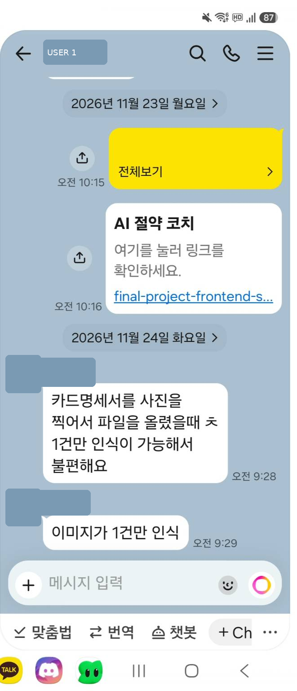
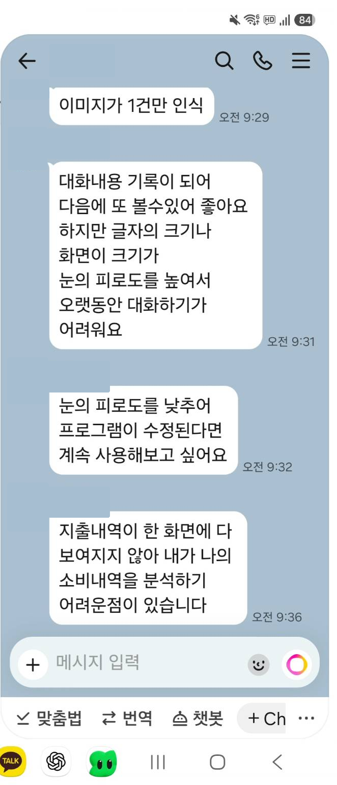

# AI 소비 패턴 분석 및 절약 코치 — 외부 사용자 피드백 2건

- 기록일: 2026-11-24
- 인원: 외부 사용자 2명 (카카오톡 메시지로 수집한 사용 의견)
- 증빙: 실명 및 프로필 사진을 가린 스크린샷 4장 (외부 사용자 1: 3장, 외부 사용자 2: 1장)
- 구분: 사용자 의견 기록이며, 개발자가 같은 문제를 직접 재현·검증한 결과는 아닙니다.

## 결과 요약

| 구분 | 확인된 사용자 의견 | 판단 및 후속 과제 |
|---|---|---|
| 외부 사용자 1 | 카드명세서를 사진으로 촬영해 파일을 올렸을 때 지출 내역이 **1건만 인식되어 불편함** | **개선 필요:** 여러 거래가 포함된 카드명세서 이미지 인식 여부 재현 및 누락 건수 확인. 대화 글자·화면 크기 조절 및 지출내역 전체 조회 편의성 개선 검토 |
| 외부 사용자 2 | **지출 항목의 세부 분석과 그래프가 지출 내역을 한눈에 확인하기 좋음**. 다만 **내부 로그인 오류 등이 해결되어 안정화된다면** 사용자 편의성과 절약 방안 제시가 적절하다는 의견 | **긍정 의견 + 조건:** 분석·그래프의 장점 유지, 로그인·세션 오류 여부 확인 |

## 외부 사용자 1 — 카드명세서 인식과 대화 가독성

- **관찰:** 사용자 메시지에서 카드명세서 사진 업로드 시 지출 내역이 한 건만 인식된다는 불편을 제기함
- **긍정 의견:** 대화 내용이 기록되어 나중에 다시 볼 수 있는 점이 좋다는 평가
- **추가 불편 1 — 대화 가독성:** 글자와 화면 크기가 눈의 피로도를 높여 장시간 대화하기 어려움
- **추가 불편 2 — 지출내역 조회:** 지출내역이 한 화면에 모두 표시되지 않아 자신의 소비내역을 분석하기 어렵다는 의견(2026-11-24 추가 메시지)
- **재사용 의향:** 눈의 피로를 줄이도록 개선된다면 계속 사용해 보고 싶다는 의견
- **미확인:** 실제 이미지 내 전체 거래 건수, 해당 증상 재현 여부, 오류의 정확한 원인
- **개선 과제:** 다수 거래가 포함된 카드명세서 사진을 개인정보 없이 확보하여 실제 건수와 인식 건수를 비교하고, 누락된 거래가 있는지 확인. 대화 글자 크기 조절, 화면 밀도 및 장시간 읽기 편의성 검토. 지출내역의 전체 목록 확인, 스크롤·페이지 이동, 필터·기간 조회 등 탐색 기능을 사용자 관점에서 검토
- **상태:** 사용자 제보 접수 / 개발 검증 및 개선 필요

## 외부 사용자 2 — 분석 가독성 및 로그인 안정성

- **장점:** 세분화된 지출 분석과 그래프 시각화에 대해 긍정적 평가
- **조건:** 로그인 오류 등이 없이 안정화된다면 사용 편의성과 절약 방안 제시도 양호하다는 조건부 평가
- **미확인:** 로그인 오류의 실제 재현 여부, 발생 빈도, 해결 완료 여부
- **개선 과제:** 로그인, 새로고침, 재로그인, 세션 유지 시나리오를 점검하고 오류 발생 시 안내 강화
- **상태:** 긍정적 사용 의견 확인 / 안정성 추가 확인 필요

## 검증 범위 및 향후 조치

- 이번 기록은 **2명에게서 수집한 피드백**이며, 두 명이 동일한 시나리오의 전체 테스트를 수행했다고 단정할 수 없습니다.
- 실제 인식 정확도, 로그인 성공률, 만족도 점수는 측정되지 않았습니다.
- 사용자 피드백과 개발자의 테스트·결함 재현·수정 완료는 구분합니다.
- [ ] 카드명세서 다건 인식 사례 재현 및 개선 전후 비교
- [ ] 글자 크기 조절·대화 화면 가독성 개선 검토 및 사용자 재확인
- [ ] 지출내역 전체 조회·탐색 편의성 검토 및 사용자 재확인
- [ ] 로그인 및 세션 오류 시나리오 재현 여부 확인
- [ ] 기능 수정 후 회귀 테스트 및 재사용자 확인
- [x] 공개용 증빙 이미지에서 실명·프로필 사진 가림

개인정보 보호를 위해 카카오톡 원본 이미지 대신 익명화된 파일만 공개 저장소에 등록합니다.
